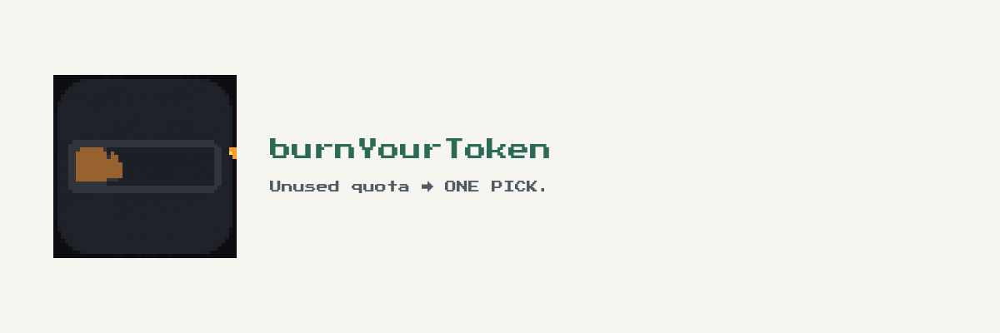
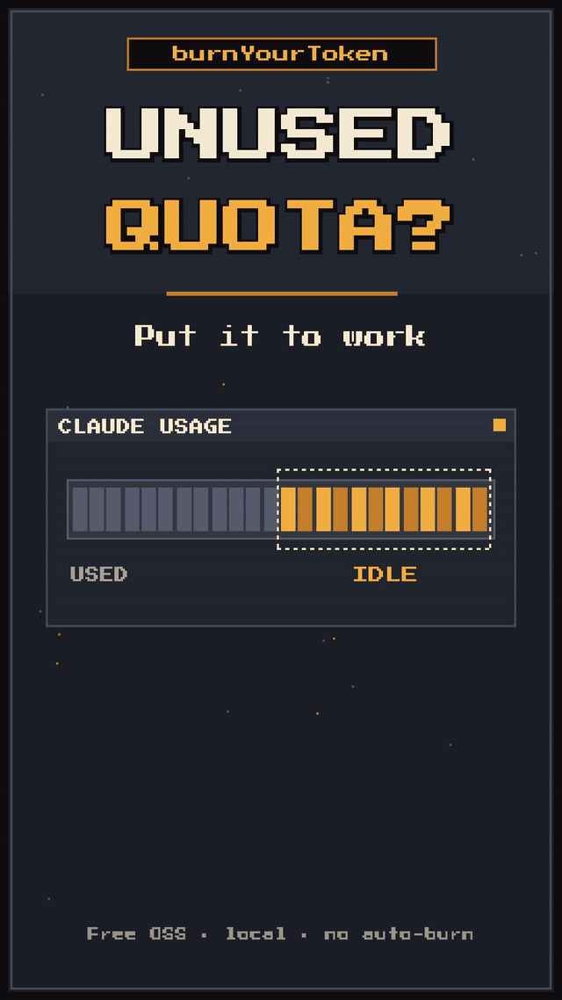

<p align="center">
  <picture>
    <source media="(prefers-color-scheme: dark)" srcset="docs/brand/readme-lockup-dark.png">
    
  </picture>
</p>

# burnYourToken

[](LICENSE) [](https://github.com/coindef/burnYourToken/stargazers)

**Unused Claude quota?**

Fill from Usage → **ONE PICK** → **Mark done**. Nothing auto-burns.

Free OSS · local · Chrome extension

<p align="center">
  
</p>

### Load unpacked (30 seconds)

1. `chrome://extensions` → Developer mode → Load unpacked → select `extension/`
2. Open Claude → Settings → Usage (`https://claude.ai/settings/usage`) and leave the tab open
3. Run `sh scripts/serve.sh` → open http://127.0.0.1:8000/ → **Fill from Claude Usage** → choose a plan → **Get project** → pick the one card → **Mark done**

Without the extension: copy **Session**, **Resets in**, and **Weekly** by hand.

Star the repo if the Fill→Mark done loop helped.

## What it does

- **Fill** reads the open Usage tab only when you click **Fill from Claude Usage**. It copies **Session**, **Resets in**, and **Weekly**. It does not calculate, and it does not mark a project done.
- **One** full-width recommendation. **Get project** is the click that shows it. The main path does not add a second card.
- **Mark done** is explicit. The project stays unfinished until you click it.

*Usage monitors show leftover quota. burnYourToken fills IDLE / UNUSED into one pick, then Mark done — nothing auto-burns.*

## Run

Python 3. No install and no build.

```sh
sh scripts/serve.sh
```

Open http://127.0.0.1:8000/. Another port: `PORT=8765 sh scripts/serve.sh`. Stop with Ctrl+C in that window.

The server listens on `127.0.0.1` only.

You can open `index.html` directly. It only loads `css/` and `js/` next to it. If the extension should work on that `file://` page, open the extension’s details and turn on **Allow access to file URLs**.

**Fill from Claude Usage** only copies the three numbers. Click **Get project** for the recommendation. **Try sample** under **More** fills the example numbers and runs **Get project**.

Leave a field blank and **Get project** marks that field. A percent outside 0–100 must be 0–100. **API billing** has no session or weekly window, so this tool does not apply.

## Tests

Optional. Needs Chrome or Chromium. The script looks for the real browser. If `google-chrome` on your PATH is a wrapper and the run never finishes, set `CHROME` to the binary.

```sh
sh tests/run.sh
CHROME=/full/path sh tests/run.sh
```

The tests only talk to `127.0.0.1`. A passing run exits 0.

## Privacy

Local only. The page does not call the network. The extension does not call the Claude API. It reads the Usage tab you already have open, and only after you click **Fill from Claude Usage**. Preferences stay in this tab until you close it.

## Contributing

Issues and pull requests are welcome. Keep changes local, keep this README in English, and keep **Fill**, **Get project**, and **Mark done** as separate clicks.

## License

[MIT](LICENSE)

## Disclaimer

Unofficial. Not affiliated with Anthropic.
